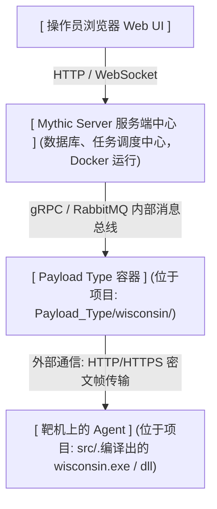

# 关于file功能

包含file browser和file上传下载功能



官方文档
https://docs.mythic-c2.net/version-4.0/customizing/hooking-features/file-browser

项目实现在src/commands/file.rs

# 生命周期及各组件之间的配合

 Web UI做的事情：仅仅是帮操作员省去了手打参数的繁琐。当你在网页上点文件夹时，Web
  UI 自动帮你生成了包含 full_path、path、file、host 的参数并提交给 ls.py 容器.ls.py 经过加工后，给 Agent 的是 full_path（或 path + file 拼接的值）(优先将 full_path 提取出来若 full_path 为空，则把 path + file 拼成完整路径后下发给 Agent)

操作员在命令行控制台手敲 ls（根本没有这 4 个字段）而是一串纯文本 "." 或 "..\\Temp"
ls.py 的 else 分支直接把操作员输入的字符串打包成 {"path": "."} 发给
  Agent


  任务存放在服务端的任务队列里，静静等待 Agent 来取
  Agent 必须主动拉取：Agent 按照心跳周期主动发起 get_tasking
  请求，从服务端的应答报文中获取该任务及其 task_id

  Agent / CallbackUUID(Agent的身份身份证)服务端 在 Agent首次上线(checkin)注册或编译时分配.上线阶段就已常驻Agent 内存（如Wisconsin 的 session.active_uuid）

Task ID(本次 ls任务流水号)服务端 在 Web UI触发任务入库时生成的随机 UUID.Agent 在心跳轮询get_tasking时从服务端返回的数据中读出


阶段 1：操作员 Web UI 触发原始请求

  • 发出位置：前端 React 视窗通过 GraphQL Mutation 发送。
  • 载荷结构体 (UI 发送给 Mythic Core 的 JSON)：
    ```
    {
      "host": "TARGET-PC",
      "path": "C:\\Users",
      "file": "Administrator",
      "full_path": "C:\\Users\\Administrator"
    }
    ```
  • 字段作用：path 为父目录，file 为当前操作的目标节点，full_path
  为绝对路径（若有）。
  

  或

  操作员控制台交互触发（手动输入）：
      • 操作员直接在 Callback 终端输入 ls
      C:\Users\Administrator，此时发送的是普通的非 JSON 字符串

  ──────

  阶段 2：Payload 容器处理与参数重塑 (PTTaskMessageAllData)

  • 组件：ls.py
  • 输入结构体 (PTTaskMessageAllData)：
    ```
    class PTTaskMessageAllData:
        Task: PTTaskMessageData    # 包含 command="ls",
  command_line="<阶段1的JSON>"
        Callback: PTCallbackData  # 包含宿主主机名、当前用户、PID 等上下文
        args: LsArguments         # 待填充的参数解析器对象
    ```

  • 增量演变与重塑操作：
      1. 剔除/拼接：丢弃零散的 path + file，智能规范化为符合靶机 OS
      标准的单一绝对路径；
      2. 提取：提取 host 参数；
      3. 新增任务状态展示字段：生成 DisplayParams。

  • 输出结构体 (PTTaskCreateTaskingMessageResponse)：
    ```
    PTTaskCreateTaskingMessageResponse(
        TaskData=taskData,
        Success=True,
        DisplayParams="Listing: C:\\Users\\Administrator on TARGET-PC"
    )
    ```

  此时存入服务端 PostgreSQL 数据库的 Task 参数已被清洗为规范键值对：{"path":
  "C:\\Users\\Administrator", "host": "TARGET-PC"}，状态从 Preprocessing 置为
  Submitted。

  ──────

  阶段 3：下发通道中的任务载荷 (MythicTaskRef)

  • 组件：经过 C2 Profile 解密后送达 Agent 调度中枢 engine.rs。
  • Agent 端数据结构 (Rust 零堆借用结构体)：
    ```
    pub struct MythicTaskRef<'a> {
        pub id: &'a str,          // 任务唯一 UUID，如 "9b1deb4d-3b7d-4bad-
  9bdd-2b0d7b3dcb6d"
        pub command: &'a str,     // 固定为 "ls"
        pub parameters: &'a str,  // 阶段 2 清洗后的 JSON 字符串
    }
    ```

  • 增量演变：Agent 调度器仅关注 parameters 中的 path
  字段，作为物理枚举的真实目标。

  ──────

  阶段 4：靶机物理采集与纯栈暂存 (TaskExecutionWorkspace)

  • 组件：file.rs 中的 execute_ls 函数。
  • 底层物理信息采集（增量探针）：
      1. Win32 API GetFullPathNameW
      校验并分离出：parent_path（"C:\\Users"）与
      dir_name（"Administrator"）；
      2. std::fs::metadata
      探测目标的：尺寸（size）、最后访问时间（access_time
      毫秒级）、最后修改时间（modify_time 毫秒级）；
      3. std::fs::read_dir 收集子目录和子文件的元数据。

  • Agent 纯栈工作区暂存结构体：
    ```
    // 1. 父目录元数据暂存 (FileBrowserMeta)
    pub struct FileBrowserMeta {
        pub is_set: bool,
        pub is_file: bool,        // false
        pub success: bool,        // true
        pub size: u64,
        pub access_time: u64,     // Unix Epoch 毫秒
        pub modify_time: u64,
        pub name_offset: usize,   // "Administrator" 存储偏移
        pub parent_path_offset: usize, // "C:\\Users" 存储偏移
        pub file_count: usize,    // 实际枚举到的条目数 (上限 32)
    }

    // 2. 子条目持久缓存切片 (FileBrowserChildItem)
    pub struct FileBrowserChildItem<'a> {
        pub is_file: bool,        // 是否为常规文件 (false 代表子目录)
        pub name: &'a str,        // 文件名 (如 "ntuser.dat")
        pub access_time: u64,
        pub modify_time: u64,
        pub size: u64,
    }
    ```

  ──────

  阶段 5：回传报文序列化 (FileBrowserResponse)

  • 组件：由 Agent 在下一次心跳时打包进 post_response。
  • Rust 顶层结构体 (protocol.rs)：
    ```
    pub struct TaskResponseItem<'a> {
        pub task_id: &'a str,
        pub user_output: Option<&'a str>, // 为 ""，不污染控制台输出
        pub completed: Option<bool>,       // Some(true)
        pub status: Option<&'a str>,       // Some("success")
        pub file_browser: Option<FileBrowserResponse<'a>>, // 挂载核心结构体
    }
    ```

  • 实际网络物理 JSON (密文内部明文)：
    ```
    {
      "action": "post_response",
      "responses": [
        {
          "task_id": "9b1deb4d-3b7d-4bad-9bdd-2b0d7b3dcb6d",
          "completed": true,
          "status": "success",
          "file_browser": {
            "host": null,
            "is_file": false,
            "name": "Administrator",
            "parent_path": "C:\\Users",
            "success": true,
            "access_time": 1729000000000,
            "modify_time": 1729000000000,
            "size": 0,
            "update_deleted": null,
            "set_as_user_output": null,
            "files": [
              {
                "is_file": true,
                "name": "ntuser.dat",
                "size": 262144,
                "access_time": 1729000000000,
                "modify_time": 1729000000000
              },
              {
                "is_file": false,
                "name": "Documents",
                "size": 0,
                "access_time": 1729000000000,
                "modify_time": 1729000000000
              }
            ]
          }
        }
      ]
    }
    ```

  • 关键控制位语义：
      • host: null：告知 Mythic 自动绑定当前 Callback 所在主机。
      • update_deleted: null：增量合并模式
      (Merge)，防止未翻页的文件被错误标记为删除。
      • set_as_user_output:
      null：避免服务端把文件列表重复序列化成文本刷屏控制台。

  ──────

  阶段 6：服务端入库与图元映射 (filebrowserobj)

  • 组件：Mythic Server 核心处理引擎 + PostgreSQL 数据库。
  • 数据库映射持久化模型 (filebrowserobj 表)：

  服务端接收到 file_browser 字典后，在数据库中拆分为节点记录：

  ```
   记录类型         | 字段名          | 数据库值         | 说明与增量演变
  ------------------|-----------------|------------------|-------------------
   当前已访问目录   | full_path_text  | C:\Users\Adminis | 绝对路径
                    |                 | trator           |
                    | name            | Administrator    | 节点名
                    | parent_path     | C:\Users         | 外键级联父节点
                    | has_been_listed | true             | 【增量核心】标记
                    |                 |                  | 已探索，前端据此
                    |                 |                  | 点亮绿色对勾
                    | deleted         | false            | 存活状态
   子文件列表条目(  | full_path_text  | C:\Users\Adminis | 级联拼接完整路径
   例如 ntuser.dat) |                 | trator\ntuser.da |
                    |                 | t                |
                    | name            | ntuser.dat       | 文件名
                    | parent_path     | C:\Users\Adminis | 归属刚刚列举的目
                    |                 | trator           | 录
                    | has_been_listed | false            | 仅被发现，但尚未
                    |                 |                  | 对该条目执行过列
                    |                 |                  | 举
                    | size            | 262144           | 物理尺寸
  ```


## file browser中payload组件需要实现

For the file browser, there are a few capabilities that need to be present and implemented correctly if you want to allow users to list, remove, download, or upload from the file browser. Specifically:

File Listing - there needs to be a command marked as supported_ui_features = ["file_browser:list"] with your payload type that sends information in the proper format.

File Removal - there needs to be a command marked as supported_ui_features = ["file_browser:remove"] with your payload type that reports back success properly

File Download - there needs to be a command marked as supported_ui_features = ["file_browser:download"] with your payload type

File Upload - there needs to be a command marked as supported_ui_features = ["file_browser:upload"] with your payload type

这里是指在payload type中用来处理参数翻译的各种py文件应当遵守的规范.

其中command指位于项目  目录下的 Python 指令定义文件中的 CommandBase 类

文档中的四大能力         | 在项目中的… | 对应的 Python 类
  --------------------------|-------------|----------------------------------
   File Listing (文件列表)  | ls.py       | class LsCommand(CommandBase):
   File Removal (文件删除)  | agent_funct | class RmCommand(CommandBase):
                            | ions/rm.py  |
                            | (若实现)    |
   File Download (文件下载) | download.py | class
                            |             | DownloadCommand(CommandBase):
   File Upload (文件上传)   | upload.py   | class
                            |             | UploadCommand(CommandBase):

 supported_ui_features 的作用：
  1. 注册阶段：
  Python 容器启动时向 Mythic 汇报："我是 wisconsin。我有个命令叫 ls，它打上了
  file_browser:list 的标签。"
  2. UI 触发阶段：
  操作员在文件浏览器图形界面点击某文件夹时，Mythic
  服务端到数据库一查："wisconsin 哪个命令支持 file_browser:list？" → 查到了是
  ls！
  3. 下发阶段：
  Mythic 自动为你组装好 ls 任务，下发给靶机上的 Rust Agent。
  4. 渲染阶段：
  Rust Agent 的 engine.rs 执行完毕，打包 FileBrowserResponse
  发回服务端。Mythic 解析后，把文件呈现在网页的文件树上。

When doing a file listing via the file browser, the command_line for tasking will always be the following as a JSON string (this is what gets sent as the self.command_line argument in your command's parse_arguments function):

```
{
  "host": "hostname of computer to list",
  "path": "path to the parent folder",
  "file": "name of the file or folder you're trying to list",
  "full_path": "absolute path to the file/folder"
}
```

This might be different than the normal parameters you take for the command marked as supported_ui_features = ["file_browser:list"]. Since the payload type's command handles the processing of arguments itself, we can handle this case and transform the parameters as needed. 即这四个字段不是必须都存在

## agent端

全量response(Wisconsin中是src/protocol.rs/FileBrowserResponse)

```json
{
    "action": "post_response",
    "responses": [
        {
            "task_id": "UUID of task",
            "file_browser": {
                "host": "hostname of computer you're listing", // optional
                "is_file": false,
                "permissions": {json of permission values you want to present},
                "name": "name of the file or folder you're listing (just the name, not the full path)",
                "parent_path": "full path of the parent folder (full path of parent, don't include name of thing you listed)",
                "success": true,
                "access_time": unix epoc time in milliseconds,
                "modify_time": unix epoc time in milliseconds,
                "size": 1345, //size of the entity in bytes
                "update_deleted": true, //optional
                "set_as_user_output": true, // optional
                "files": [ // if this is a folder, include data on the files within
                    {
                        "is_file": true,
                        "permissions": {json of data here that you want to show},
                        "name": "name of the entity",
                        "access_time": unix epoc time in milliseconds,
                        "modify_time": unix epoc time in milliseconds,
                        "size": 13567 // size of the entity
                    }
                ]
            }
        }
    ]
}
```

>If you're listing out the top level folder (/ on linux/macOS or a drive like C:\ on Windows), then the parent path should be "" or null.
>Mythic doesn’t currently support ., .., or ~ paths. Any information about . should be part of the main file_browser JSON data (not part of the files array). ~ should be fixed to an absolute path.


在Wisconsin/protocol.rs/FileBrowserResponse结构体中,有几个字段被置为optional或直接省略

1. permission字段省略了,详见protocol.rs中的注释

2. host字段被置为optional,且在engine.rs置为none.因为

As a shortcut, if the file you're ls-ing is on the same host as your callback, then you can omit the host field or set it to "" and Mythic will automatically add in your callback's host information instead.

3. update_deleted(和host一样):update_deleted: true 的官方机制：告诉 Mythic
  服务端做全量快照比对——"只要我这次回传的 files
  列表里没有的文件，你就认为它已经被删除了，并在 UI 上画删除线"。
  • 我们面临的致命冲突：
  我们在栈上为文件列表设置了安全容量上限（MAX_FILES_PER_SLOT = 32）。
  假设目标目录实际有 100 个文件，Agent 单次只抓取前 32 个。如果此时把
  update_deleted 设为 true，Mythic 就会误以为后 68
  个文件全部被删除了，直接在网页上给它们画上红色的删除线
  因此，在没有做翻页分页机制之前，置为 None（默认走 Merge
  │ 合并模式）是唯一安全、不会导致前端显示灾难的做法

There are two main other scenarios that we want to support that are counter to this idea - paginated results (only return 20 files at a time) and filtered results (only return files in the folder that end in .txt). In these cases, we don't want the rest of the data to be automatically marked as deleted because we're clearly not returning the full picture of what's in a folder. That's why it's an optional flag to say to performing the automatic updates. If you want to be explicit with things though (for example, if you delete a file and want to report it back without having to re-list the entire contents of the directory), you can use the next section - File Removal.

4. set_as_user_output: None —— 保持控制台（Console）日志纯净

  • 它的作用：通知 Mythic 服务端自动把这批结构化的文件数据序列化成一大段 JSON
  文本，硬塞进任务的控制台回显（user_output）中。
  • 为什么置为 None：
  绝大多数操作员在运行图形化 C2 时，希望文件信息干净地呈现在 File
  Browser（树形图面板） 中，而不是在原本用来敲命令的交互式 Console
  终端里被几十行生硬的 JSON 刷屏。置为 None
  可以让控制台保持整洁，不污染操作员的工作流